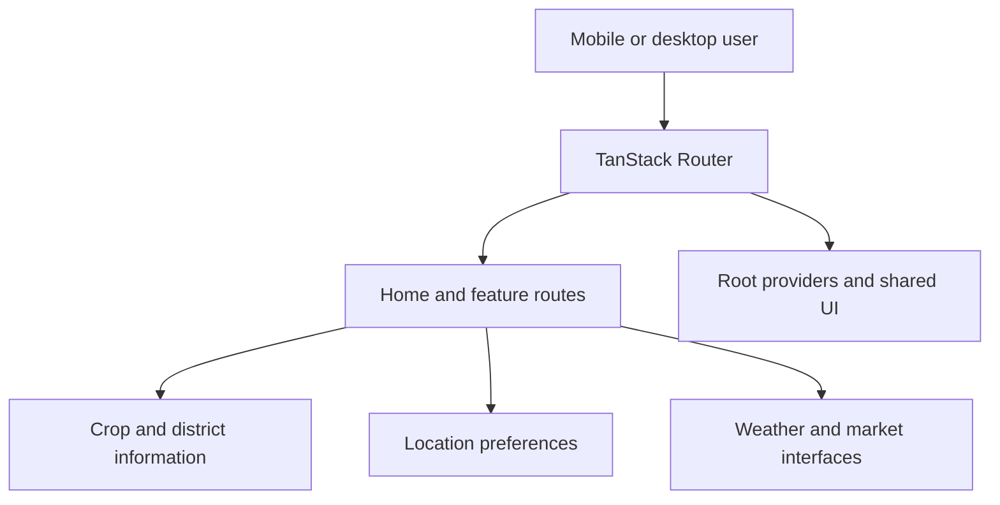

<div align="center">

# DHRUVA AI

**Farm smarter. See further. Grow better.**

Agricultural advisory web application for exploring crop information, district profiles,
weather, market prices and practical farming tools.


[Explore the web app](https://dhruvaai.lovable.app/) · [Local setup](#local-development) · [Architecture](#architecture) · [Data and safety](#data-quality-and-safety)

</div>

---

## Overview

DHRUVA AI brings agricultural information into a mobile-friendly interface for Indian farmers and learners. The repository includes a React/TanStack Start application, crop and district information, location-aware interfaces, and routes for agricultural decision-support tools.

**Project status:** Application source is present; this review inspected the route definitions, root layout, home screen and package configuration. Live service availability, agricultural accuracy, data coverage and end-to-end functionality have not been independently validated. This is an independent project, not an official agricultural advisory service.

## Explore the application

| Area | Source evidence / route |
| --- | --- |
| Crop library and detail pages | `/crops`, crop detail route |
| District information and atlas | `/districts`, district detail route, `/atlas` |
| Weather and market dashboards | `/weather`, `/market` |
| Calculators and rotation | `/calculators`, `/rotation` |
| Disease information and schemes | `/diseases`, `/schemes` |
| Analytics and paddy-focused information | `/analytics`, `/paddy-future` |
| Permissions and supporting interfaces | `/permissions`, `/about`, `/contact` |

Route presence is evidence of application structure, not proof that every underlying integration works or that all displayed data is current.

## Technology stack

| Layer | Technologies declared in the repository |
| --- | --- |
| Application | React 19, TypeScript, TanStack Start and Router |
| Data fetching | TanStack Query |
| Build | Vite 8, Lovable TanStack configuration |
| UI | Tailwind CSS 4, Radix UI, Lucide |
| Motion and visualizations | GSAP, Framer Motion, Three.js, Recharts |
| Integrations | Supabase SDK, Google Maps marker clustering, Lovable MCP tooling |
| Dependency management | Bun lockfile |

Installed dependencies are not evidence of configured or working external services.

## Local development

Install Git and Bun, and use a Node.js version compatible with the Vite toolchain. The committed Bun lockfile should be used for reproducible dependency installation.

```bash
git clone https://github.com/svsramakrishnanaidu-rgb/dhruvaai.git
cd dhruvaai
bun install --frozen-lockfile
bun run dev
```

Open the local development URL printed in the terminal.

| Command | Purpose |
| --- | --- |
| `bun run dev` | Start local development |
| `bun run lint` | Run the configured ESLint checks |
| `bun run build` | Build the application |
| `bun run preview` | Preview a compatible local build |

These are existing package scripts; successful execution is not claimed here. Some integrations may require environment configuration. Do not add duplicate Vite plugins already supplied by the Lovable configuration.

## Architecture



| File | Responsibility |
| --- | --- |
| [src/routes/index.tsx](src/routes/index.tsx) | Responsive home and feature entry points |
| [src/routes/__root.tsx](src/routes/__root.tsx) | App shell, query provider, shared UI and error states |
| [src/routeTree.gen.ts](src/routeTree.gen.ts) | Generated route inventory |
| [vite.config.ts](vite.config.ts) | Build configuration |
| [package.json](package.json) | Dependencies and development commands |

## Data quality and safety

- Treat crop guidance, fertilizer estimates, disease information and market prices as informational, not guaranteed recommendations.
- Verify agricultural inputs against local soil tests, product labels, qualified agricultural extension advice and current official sources. Do not rely on an unvalidated AI diagnosis for pesticide selection.
- Display source, observation time, geography and units for dynamic data. Clearly label stale, sample or unavailable data.
- Request only necessary location permissions; provide a manual district selection option wherever possible.
- Keep server credentials out of version control and client-exposed `VITE_*` values. Review authorization for any database or MCP endpoint before public use.

## Reviewer walkthrough

| Scenario | What to check |
| --- | --- |
| Browse a crop | Correct crop-specific content and navigation |
| Change a district | Consistency of location-dependent information |
| Open weather or market | Source, timestamps, unavailable-data states |
| Use a calculator | Area and unit handling, valid input, transparent assumptions |
| Test mobile and desktop | Layout, keyboard navigation, readability and reduced motion |

This is a proposed manual test plan, not an executed test report.

## Roadmap

- [ ] Validate sources and dates for crop, district, weather and market data.
- [ ] Verify calculator formulas and safe boundaries with domain experts.
- [ ] Record lint/build results and add appropriate automated tests.
- [ ] Review permissions, third-party integrations and server-side secrets.
- [ ] Document verified screenshots and end-to-end user journeys.

## Project origins

Built with [Lovable](https://lovable.dev). The original design requirements are preserved in [the project brief](docs/ORIGINAL_PROJECT_BRIEF.md); requirements in that document are not verified feature claims.

The existing application metadata credits **Bhaskar, Ravi, Ramakrishna and Vinay**.

[GitHub repository](https://github.com/svsramakrishnanaidu-rgb/dhruvaai) · [Lovable web app](https://dhruvaai.lovable.app/) · [Developer portfolio](https://github.com/svsramakrishnanaidu-rgb/bsr-learning)

The hosted link comes from the original project README; current availability has not been verified.

<div align="center"><sub>Technology for informed agricultural decisions · Built with care · Verify before acting</sub></div>
